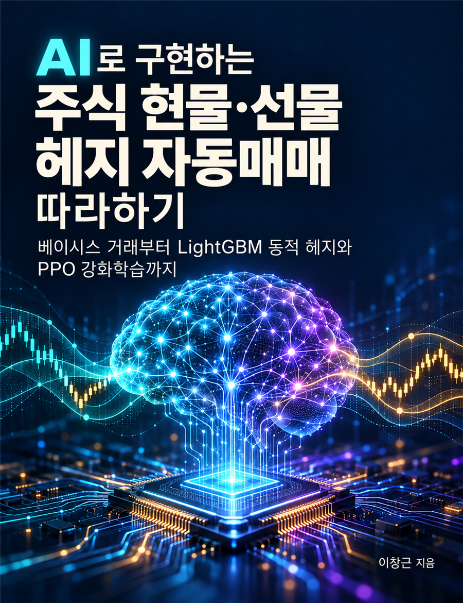

# ai-stock-futures-hedging-tutorial

<p align="center">
  <a href="https://wikidocs.net/book/21830"></a>
</p>

위키독스 책 **「AI로 구현하는 주식 현물·선물 헤지 자동매매 따라하기 — 베이시스 거래부터 LightGBM 동적 헤지와 PPO 강화학습까지」** 의 예제코드 저장소입니다.

- 책: [https://wikidocs.net/book/21830](https://wikidocs.net/book/21830)
- 장별 코드는 Git 태그(`ch01`, `ch02`, …)로 고정되어 있습니다. 책과 똑같은 결과를 보려면 해당 태그를 체크아웃하세요.

> 이 저장소의 코드는 연구·교육용입니다. 투자 권유가 아니며 수익을 보장하지 않습니다.
> 예제는 **시세 조회와 시뮬레이션만** 수행하고, 실전 주문을 자동으로 내지 않습니다.

## 빠른 시작

[uv](https://docs.astral.sh/uv/)를 사용합니다. Python 3.12 환경이 자동으로 만들어집니다.

```bash
git clone https://github.com/ady95/ai-stock-futures-hedging-tutorial.git
cd ai-stock-futures-hedging-tutorial
uv sync
uv run pytest -q                                   # 테스트
uv run python examples/chapter01/03_monte_carlo.py  # 1장 실습
```

1~2장은 **API 키 없이** 합성 데이터와 공개 파일만으로 실행됩니다.
증권사 시세를 조회하는 예제(`examples/chapter02/02_kis_futures_quote.py` 등)는 `.env.example`을 `.env`로 복사하고 본인 키를 넣은 뒤 실행합니다.

## 장별 예제

| 장 | 예제 | 내용 | API 키 |
|---|---|---|---|
| 1 | `examples/chapter01/01_same_qty_pnl.py` | 같은 수량 롱·숏의 손익과 비용 | 불필요 |
| 1 | `examples/chapter01/02_split_exit_scenarios.py` | 청산 시점 분리 — 대표 경로 5종 | 불필요 |
| 1 | `examples/chapter01/03_monte_carlo.py` | 무작위 경로 10,000개 손익 분포 | 불필요 |
| 2 | `examples/chapter02/01_listed_months.py` | 상장 결제월·최종거래일·가격제한폭, KIS 종목 마스터 대조(`--master`) | 불필요 |
| 2 | `examples/chapter02/02_kis_futures_quote.py` | KIS 현물·주식선물 시세 조회 | KIS |
| 2 | `examples/chapter02/03_margin_settlement.py` | 일일정산과 추가증거금 | 불필요 |
| 2 | `examples/chapter02/04_hedge_calculator.py` | 헤지 계약 수·순노출·마진콜 가격 계산기 | 불필요 |

## 구조

```text
src/hedging/
├── sim/           # 합성 가격 경로
├── pnl/           # 롱·숏 손익
├── instruments/   # 주식선물 계약 명세(승수·호가단위·결제월)
├── risk/          # 헤지 계약 수, 증거금·일일정산
└── data/          # KIS 조회 전용 클라이언트, 종목 마스터
examples/chapterNN/
tests/
```

## 보안·데이터 원칙

- `.env`(API 키·계좌번호), `.cache/`(토큰), `data/raw/`(원시 실데이터), `outputs/`는 커밋하지 않습니다.
- 증권사·거래소 데이터는 각 약관에 따라 재배포하지 않고, 저장소에는 합성 데이터만 둡니다.

## 라이선스

MIT
